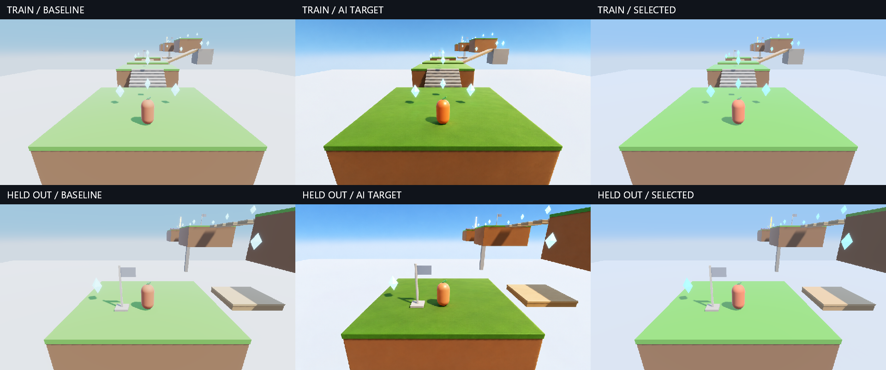

# Image guided graphics pilot in Cloudstep

A bounded experiment completed the loop from an actual Cloudstep capture, through a generated appearance target, to a GPU-selected rendering policy and a complete native game replay. The selected policy reduced a foreground color-and-tone proxy by **16.2% on the fitting view and 5.3% on the held-out view**. This is a modest positive result for the workflow. The selected render remains visibly far from the generated target; perceptual realism and an engine-wide visual identity are unqualified.

The winner was **PathDiffuse with 0.70 tone-map color retention**. It is an opt-in research look. Cloudstep and the engine retain their existing defaults.



## Frozen experiment

The fitting image is the initial game camera at checkpoint 0. The held-out image is the initial camera at checkpoint 1. Both use simulation time zero and 960×540 output. Geometry, authored colors, exposure, sun, ambient, fog, AO and bloom remain fixed. Single-frame captures disable temporal AA; the native game run restores the game's temporal AA setting.

The candidate family was declared before generation: five direct diffuse models (Lambert, Burley, Frostbite, EON and PathDiffuse) crossed with retention weights 0, 0.35 and 0.70. There are 15 complete policies. This deliberately tests diffuse response separately from a color-mapping axis. It does not fit textures, geometry, ambient light, exposure, shadow softness or material roughness.

Two built-in imagegen edits generated the references. The second uses the first as a color/shading reference while retaining its own game capture as the layout. Exact prompts are retained as `train-prompt.txt` and `heldout-prompt.txt`. Frozen saved images, rather than prompt regeneration, are the reproducible reference inputs.

The frozen inputs are the [fitting target](assets/image-guided-look/train-target.png), [held-out target](assets/image-guided-look/heldout-target.png), [fitting prompt](assets/image-guided-look/train-prompt.txt), [held-out prompt](assets/image-guided-look/heldout-prompt.txt) and [reference admission](assets/image-guided-look/reference-review.json). The [protocol](assets/image-guided-look/protocol.json) records the rules; [evidence](assets/image-guided-look/evidence.json) retains scores, measurements and hashes.

The generated images retained the main cameras, platform silhouettes and subject positions closely enough for **coarse foreground color fitting**. They also added surface variation, changed shadow softness and highlights, and altered the sky/cloud gradients despite the prompt. `reference-review.json` records that limited admission. These are aesthetic targets with documented drift, not calibrated relighting references or exact pixel correspondences. This review was performed by Codex before fitting; it is not an independent human preference study.

## Metric and selection

A white geometry capture masks the course and hero. The mask excludes clear sky, Cloudstep's cloud-colored geometry and emissive model pickups. A four-pixel square erosion removes silhouette boundaries. The cloud-color rule is specific to this fixture, not a general semantic segmentation facility.

Each occupied cell of a 24×14 grid averages foreground pixels in linear RGB, converts the average to D65 CIELAB, and measures Euclidean distance to the generated reference's corresponding foreground patch. The objective is the root mean squared patch distance. Cells with fewer than 16 admitted pixels are skipped. All admitted cells have equal weight. Exact self-comparison and arbitrary changes to excluded background pixels must give zero loss.

This objective measures broad color/tone agreement. It does not measure realism, motion quality, shadow correctness, texture quality or gameplay readability. It also cannot fully separate lighting from material color when the generator changes both.

Eligibility requires median measured GPU-frame cost no greater than `baseline * 1.25 + 0.15 ms`, and a foreground clipped-channel fraction no greater than baseline plus `0.005`. A clipped channel is an output byte at least 254. Cost uses 20 rotating samples per candidate after five warmup cycles, through the same dynamically branched production shaders. These measurements are local to the RTX 3070 and uncontrolled desktop GPU clocks.

Eligible candidates receive the integer utility `round(1000000 / (1 + training loss))`. A compiled VTS `when utility` expression evaluates these measured scores on Vulkan. Its returned candidate ID selects the actual rendering settings. An independent host calculation checks the result; native tie and no-eligible cases check source-order preference and the explicit fallback. The GPU readback ID, scores and shader hashes are retained. This is offline selection; generation and image scoring do not run during gameplay.

The measured scores are embedded constants in the generated utility shader, so shader optimization may fold the decision. This qualifies publishing a deterministic choice through the VTS/native path; it does not benchmark dynamic GPU arbitration or image scoring on the GPU. The winner is fixed for the game run.

Selection is saved before loading the held-out target into the scoring path. The frozen pass criteria were at least 10% fitting-loss reduction, at least 5% held-out-loss reduction, and the clipping gate on both views. Reference hashes are locked: changing either target or its admission requires a separate experiment directory.

## Results and attribution

The fitting baseline loss was 29.50684. These are comparisons within the frozen candidate set:

| Policy | Fitting loss | Reduction from baseline |
| --- | ---: | ---: |
| Lambert, original curve | 29.50684 | baseline |
| Frostbite, original curve | 27.95819 | 5.2% |
| PathDiffuse, original curve | 27.28847 | 7.5% |
| Lambert, retention 0.70 | 26.02923 | 11.8% |
| Frostbite, retention 0.70 | 25.35900 | 14.1% |
| PathDiffuse, retention 0.70 | 24.72260 | 16.2% |

The selected policy's held-out loss was 28.36001 versus 29.95002 for baseline: **5.31% improvement**, narrowly above the frozen 5% criterion. The held-out target did not select or tune the winner. One held-out view does not establish statistical confidence or transfer to other lighting, games or art styles.

The final cost medians were **1.144448 ms baseline and 1.148736 ms selected per GPU frame** at 960×540, an observed increase of about 0.4%. The timing spread and uncontrolled clocks do not establish a statistically meaningful difference or a portable performance guarantee. The selected fitting clipped-channel fraction rose from zero to **0.4959%**, close to the allowed 0.5 percentage-point increase. Held-out clipping was **0.4051%**. Burley and EON at retention 0.70 failed the fitting clipping gate. The winner's proximity to the limit is a reason to improve gamut handling before considering a default.

The production output shader passed 120 native reference cases against double-precision curve equations, including black, neutral, HDR colors, four retention weights and three exposures. Maximum linear RGB error was 0.004635, including final 8-bit quantization. Disabling tone mapping produced identical pixels across retention choices. Neutral inputs stayed neutral.

The baseline and selected policies also ran the existing **35-step native Cloudstep tour**, both completing the course with zero falls and nine collected gems. Final observations were at simulation time 34.7 seconds, after course completion. Position, time, pickups, checkpoints, support/grounded state, completion and autopilot state matched at every scripted observation. This establishes that the look runs through the actual game path without changing those simulation results. The tour supplies motion captures, not an independent perceptual evaluation of motion.

Final qualification passed the Release solution build, **1,515 tests across 33 assemblies**, the existing **1,500 native diffuse GPU reference cases**, the 120 output-curve cases and three native utility scenarios. The full build retains 14 existing third-party OpenFont warnings. The [qualification ledger](assets/image-guided-look/qualification.json) explicitly records that perceptual realism is unqualified; the [native agreement record](assets/image-guided-look/native-agreement.json) retains the replay comparison.

## Color response implementation

`Graphics3DSettings.ToneMapColorRetention` is an experimental weight in `[0, 1]`, default zero. With linear scene color `C`, exposure `e`, luminance `Y = dot(e*C, [0.2126, 0.7152, 0.0722])`, and the existing filmic function `F`:

```text
perChannel = [F(e*C.r), F(e*C.g), F(e*C.b)]
luminanceMapped = e*C * F(Y) / max(Y, 0.000001)
outputLinear = clamp(lerp(perChannel, luminanceMapped, retention), 0, 1)
```

The existing output transfer follows this operation. Retention zero executes the original output branch. This is a blend toward luminance-based mapping, with channel clipping; it is not a calibrated perceptual color model or a guarantee of hue preservation near gamut boundaries. No extra textures, LUTs or passes are added. The existing 16-byte output material carries `1 + retention` in its tone-mapping component when enabled, and zero when disabled. Custom output shaders must interpret this component as an enable value greater than 0.5 rather than requiring exact equality with one.

## Reproduce and play

From the repository root, with the repository's Vulkan/DXC/SPIR-V toolchain available:

To play the retained winner immediately:

```powershell
.\cloudstep.cmd --look-policy docs/Aurelian/assets/image-guided-look/selected-settings.json
```

To repeat capture and fitting:

```powershell
dotnet build Aurelian.slnx -c Release -m:1 -nr:false -p:UseSharedCompilation=false
dotnet run --project tools/Aurelian.GraphicsProof -c Release --no-build -- --look-research --output artifacts/local/look-replay
Copy-Item docs/Aurelian/assets/image-guided-look/*-target.png artifacts/local/look-replay/
Copy-Item docs/Aurelian/assets/image-guided-look/reference-review.json artifacts/local/look-replay/
Copy-Item docs/Aurelian/assets/image-guided-look/reference-lock.json artifacts/local/look-replay/
dotnet run --project tools/Aurelian.GraphicsProof -c Release --no-build -- --look-research --fit --output artifacts/local/look-replay
.\cloudstep.cmd --look-policy artifacts/local/look-replay/selected-settings.json
```

The fixture folder contains the original protocol, prompts, target images and the retained result. Its [source manifest](assets/image-guided-look/source-manifest.json) records the base commit and hashes of the experiment's source files. Compare the source hashes and original protocol to the current checkout before treating it as a reproduction. GPU cost eligibility can differ on another machine. Generated references and review are immutable within a fitting directory; use a fresh directory for a new target.

For the native selected-policy replay:

```powershell
.\cloudstep.cmd --look-policy artifacts/local/look-replay/selected-settings.json --playtest-script Games/Cloudstep/Playtests/tour.json --output artifacts/local/look-replay/native --save-root artifacts/local/look-replay/native/saves
dotnet test Aurelian.slnx -c Release --no-build -m:1
```

## Refinements supported by the pilot

The workflow is executable, and its small candidate family improved the declared color proxy on both views. It has not reproduced the AI target or established a preferred engine look. The useful next iteration is to improve the experiment's evidence and candidate coverage:

1. Keep a separate score and visual review for broad color, material response, shadows and added detail. A single generated beauty image mixes these causes; a diffuse formula cannot reproduce all of them.
2. Use material/region-balanced comparisons for the hero, grass, earth and neutral structures. Equal spatial cells can reward large surfaces while underweighting the character. Add blind human preference alongside the engineering score.
3. Use perceptual gamut compression and a wider exposure/lighting stress set before promoting the retention curve. The selected policy sought the high-retention boundary and nearly exhausted the clipping budget.
4. Freeze several generated targets per appearance brief, plus additional unseen cameras and lighting conditions. The 5.31% transfer result is too close to its threshold to support a broad conclusion.
5. Audit palette color space before fitting another BRDF. Cloudstep currently normalizes hex palette bytes directly before linear lighting. This experiment froze those values; it does not establish whether the palette was authored as linear or sRGB. A color-space correction should be an explicit authoring experiment, not compensation hidden inside diffuse.

Related research supplies useful components, rather than a novelty claim for this workflow: [Instruct-NeRF2NeRF](https://arxiv.org/abs/2303.12789) uses diffusion-edited images to guide an underlying scene; [DiffusionRenderer](https://research.nvidia.com/labs/toronto-ai/DiffusionRenderer/) produces lighting from geometry/material buffers; [EON](https://jcgt.org/published/0014/01/06/paper.pdf) supplies the colored multiple-scattering background for our separate [PathDiffuse experiment](diffuse-comparison.md). This pilot explores generated appearance targets compiled into inexpensive ordinary game rendering.
