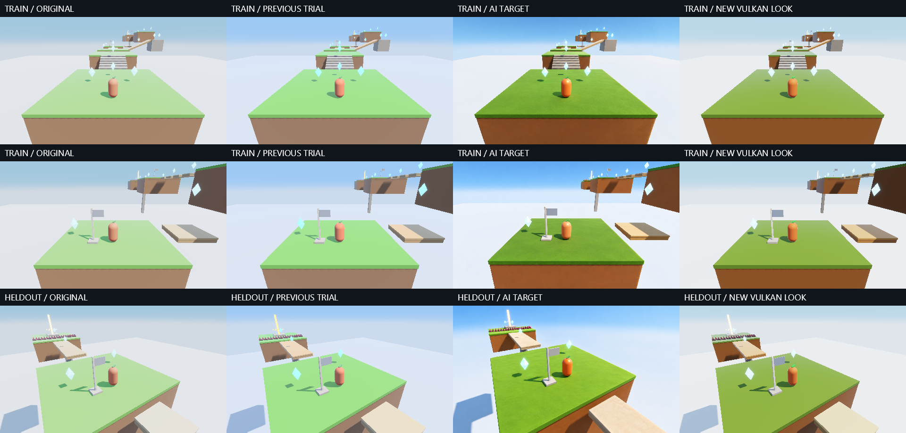

# Image guided look refinement in Cloudstep

The later [semantic calibration trial](semantic-look-calibration.md) resolves the pixel-registration blocker for a separately declared material-distribution objective, keeps PathDiffuse fixed and changes the current shaded default to PathDiffuse. This page preserves the second trial's original results and defaults at the time of measurement.

The second trial produces a visibly richer **actual Vulkan look**: orange hero, deeper green platforms and brown earth. A bounded CPU search reduced a material-balanced training error by **45.5% versus the previous selected look**, with zero measured foreground clipping in the selected stills. The new profile runs through the ordinary native game and preserves all 420 compared simulation observations across a complete course replay.

**The fresh-camera transfer experiment did not qualify.** Its frozen criterion failed, then a landmark check revealed that the generated reference had moved the scene upward by roughly 39 pixels at 960×540. One correction attempt repeated the displacement and was rejected before scoring. This is meaningful progression in controllable color appearance, with an isolated reference-registration blocker; it is not a successful generalization or realism result.



The first two rows are training views. The bottom AI target is the rejected, displaced reference; its raw score must not be interpreted as material-transfer evidence. Generated pixels are never used as game textures or screen overlays.

## What changed

The [first pilot](image-guided-look-pilot.md) kept authored colors and lighting fixed. This trial tests those assumptions alongside diffuse response:

- An opt-in Cloudstep palette profile decodes authored hex colors from sRGB to linear reflectance and applies separate RGB multipliers to hero, grass and earth. Conversion is cached by source color and immutable mesh. Geometry, transforms, collision, alpha and explicit model materials are preserved. Cloud-colored background geometry and model pickups are excluded.
- Existing sky/ground ambient intensity, exposure, diffuse model and tone-map retention are searched together. Calibration belongs to the game's presentation data; the diffuse shader is not secretly recolored.
- `Graphics3DSettings.ToneMapGamutCompression`, default false, adds a small soft compression toward the linear-RGB neutral axis before display encoding. The existing output pass and 16-byte uniform carry it; no extra pass, texture, LUT or runtime inference is required.
- An offline CPU coordinate search evaluates real Vulkan captures. A softmax over finalist scores reports how ambiguous the choice is. The selected profile is fixed during gameplay.

The authored palette used normalized hex components directly in a renderer that consumes linear colors. Decode-only is therefore a useful control. This does not establish that every palette in every game should be decoded: existing content may deliberately compensate for the old convention.

The gamut operator is a deliberately small RGB surrogate. It maps a ray from neutral toward the current color into the display cube with a soft shoulder beginning at normalized distance 0.8. It preserves neutral inputs and handles saturated channels more gently than clipping. It is **not ACES 2** and does not guarantee perceptual hue preservation. ACES 2 uses a substantially more involved perceptual-space gamut mapping; see its [official gamut-compression description](https://docs.acescentral.com/system-components/output-transforms/technical-details/gamut-compression/).

## Frozen protocol and selection

Both earlier cameras and generated references are now explicitly training data. A new checkpoint-2 camera, yaw offset +0.6 radians and pitch 0.45, was captured before fitting. View hashes check that geometry and camera did not change. The [protocol](assets/look-refinement/protocol.json) was saved before the new reference and search.

The objective gives equal weight to **hero, grass, earth and structure**, so the large grass platform cannot overwhelm the small hero. A native semantic-region capture is eroded by four pixels. Within each region, 24×14 patch means are measured in D65 Lab, supplemented by 10th/90th percentile luminance errors: 80% patch RMSE, 20% quantile error. Self-comparison and changes to excluded background pixels both produce exactly zero loss. This measures coarse color and tone agreement, not realism, texture or motion quality.

The coarse grid contains 216 profiles: decode on/off, Lambert/Frostbite/PathDiffuse, four ambient scales, three exposures and three retention weights, with compression enabled. Five controls are evaluated. The best two **distinct diffuse models** seed three coordinate-refinement passes over ambient, exposure, retention and nine palette components. The hard limit was 420 evaluations; the actual run used **360 unique profiles**.

Training eligibility requires at most 0.1% clipped foreground channels. Timing uses 30 rotating GPU-frame samples after five warmup cycles and a gate of `original * 1.25 + 0.15 ms`. Selection and the exported profile are written before the fresh held-out reference is scored. The declared outcome requires at least 30% improvement over the previous look in training, 20% on the fresh camera, and improvement in every fresh-camera material over the original.

The CPU uses deterministic minimum loss. Temperature-1 stable softmax gives the first finalist 13.17% and the second 12.83% among eight close profiles. These are score weights, **not calibrated probabilities of visual correctness**. There was no need for a learned CPU model. The previous native VTS `when utility` path also continues to pass; parameter ambiguity is not a language failure.

## Results and limits

| Policy or control | Mean training loss |
| --- | ---: |
| Original authored look | 23.6921 |
| Previous PathDiffuse / retention 0.70 | 21.3182 |
| sRGB decode only | 19.6483 |
| Ambient reduction only | 18.9136 |
| Previous look plus gamut compression | 21.8695 |
| Selected complete profile | **11.6162** |

These are the new balanced objective's values; they cannot be directly compared with the first pilot's differently weighted metric. Both training views and all four training material groups improve over the original and previous look. Selected training-view losses are 8.4134 and 14.8190. Selected clipped-channel fractions are zero; the previous look measures about 0.398% under the new masks.

The [selected profile](assets/look-refinement/selected-profile.json) uses sRGB decode, Lambert, ambient scale 0.81873, exposure 1.2, retention zero and compression enabled. RGB multipliers are grass `(1.64872, 0.49659, 0.49659)`, earth `(1.22140, 1.34986, 0.74082)`, hero `(0.81873, 1.64872, 0.90484)`. These depend on the source palette; a green multiplier above one can still produce a stronger orange by changing the relationship between a source color and its lighting response.

**Lambert winning does not establish that Lambert is better than PathDiffuse or Frostbite.** Palette, illumination and tone mapping are confounded, and only two diffuse families received the full palette refinement. This result identifies a useful joint profile within the searched budget. All diffuse options remain available; engine and ordinary Cloudstep launch defaults are unchanged.

Local RTX 3070 medians at 960×540 were **1.14336 ms original, 1.14717 ms previous, 1.15142 ms selected**: about 0.7% above original. Desktop clock variability and a single device preclude a portable or statistically significant performance claim. CPU search and scoring are offline; these timings measure GPU frames rather than end-to-end application cost.

Nine post-selection exposure/sun stress captures expose a limit: clipping remains zero in five cases, but reaches **0.398% at 2× exposure and 2× sun**, exceeding the training gate. Compression alone does not make this profile robust to arbitrary illumination. The renderer also lacks the target's surface variation, nuanced contact shading and background treatment. Richer color is a visible improvement, not an explanation of every difference between generated and game-rendered images.

### Reference admission failure

The first fresh target was initially admitted by an overly lenient visual check. The frozen raw result was only **5.97% held-out improvement**, below 20%, with earth worse than the original; `CriterionPassed` remains false in [evidence](assets/look-refinement/evidence.json). It must not be promoted after examining the failure.

The selected source hero occupies approximately `x459..500, y261..338`. In the generated reference its orange body occupies `x464..506, y222..296`. The entire island also moves. The material masks consequently compare different surfaces, confounding the score. The [registration failure](assets/look-refinement/reference-registration-failure.json) preserves the diagnosis. A single correction edit explicitly requested the source pixel bounds; it still produced `x457..500, y221..295`. Its [review](assets/look-refinement/confirmation-review.json) rejects it before any confirmation score, refitting or reranking.

Both new targets were built-in imagegen **edits**, using the actual fresh Vulkan capture as the edit target and the first pilot's training target only as an appearance reference. Exact [initial prompt](assets/look-refinement/heldout-prompt.txt) and [correction prompt](assets/look-refinement/confirmation-prompt.txt), both returned images and SHA-256 manifests are retained. No API/CLI fallback was used. Regenerating prompts is not deterministic; the saved images are the experiment inputs.

Training references are also approximate: a simple orange-body check finds about one pixel of extent drift in camera 0 and up to ten pixels in camera 1. Their scores support coarse appearance fitting only. The next experiment needs a **predeclared geometry-admission gate before fitting**, covering several landmarks and silhouettes rather than a single colored body. A proposed starting bound is four pixels at 960×540, followed by visual review. This is a future protocol change, not a threshold retroactively used to pass this trial. If an edit cannot meet it, use region-level art-direction judgments or geometry-conditioned generation and stop claiming registered pixel supervision. A global translation would not prove that all geometry matches.

## Native qualification and replay

Both ordinary and selected profiles completed the existing 35-step native tour: zero falls, nine gems, final simulation time 34.7 seconds. Twelve simulation fields match at every observation, **420 exact comparisons**, with no script errors. Selected observations confirm `look.palette=srgb` and `look.gamut=true`. The [agreement record](assets/look-refinement/native-agreement.json) and [native start capture](assets/look-refinement/native-start.png) establish the actual game path, without claiming human evaluation of motion.

The Release solution build and **1,518 tests across 33 assemblies** pass, with no failed or skipped tests. The initial full build reported the 14 existing third-party OpenFont warnings; the final incremental build reported zero warnings. The new output mode passes **240 native curve cases**, maximum linear-RGB vector error 0.005651 including 8-bit quantization, under the existing 0.009 bound. Disabled tone mapping is byte-identical across both gamut modes and all retention values; neutrals remain neutral. Existing **1,500 native diffuse reference cases** and three native VTS utility scenarios pass. Exact test totals, source hashes and scope boundaries are recorded in the [qualification ledger](assets/look-refinement/qualification.json).

Play the retained profile from the repository root:

```powershell
.\cloudstep.cmd --look-profile docs/Aurelian/assets/look-refinement/selected-profile.json
```

Capture the fixed views and reproduce the historical bounded search:

```powershell
dotnet build Aurelian.slnx -c Release -m:1 -nr:false -p:UseSharedCompilation=false
dotnet run --project tools/Aurelian.GraphicsProof -c Release --no-build -- --look-refinement --output artifacts/local/look-refinement-replay
Copy-Item docs/Aurelian/assets/look-refinement/heldout-target.png artifacts/local/look-refinement-replay/
Copy-Item docs/Aurelian/assets/look-refinement/reference-review.json artifacts/local/look-refinement-replay/
Copy-Item docs/Aurelian/assets/look-refinement/reference-lock.json artifacts/local/look-refinement-replay/
dotnet run --project tools/Aurelian.GraphicsProof -c Release --no-build -- --look-refinement --fit --output artifacts/local/look-refinement-replay
```

This deliberately replays the original raw failed trial, including its initially mistaken admission. Read its results alongside the retained rejection records. The correction attempt is excluded from fitting and has no confirmation score. Live gameplay uses temporal AA; still fitting captures disable it. Local full logs, both complete tours and stress images remain under `artifacts/local/look-refinement*`.
