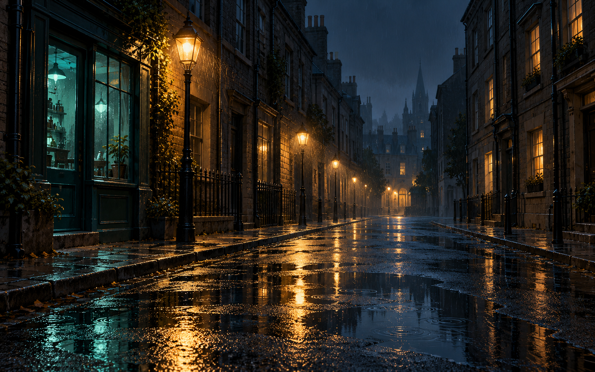

# Rain after dark: image target and native scene

The scene now also uses [generated surface maps and small mesh primitives](procedural-surfaces-and-primitives.md):
height-derived masonry/paver/asphalt normals, ORM channels, rounded trim and
revolved/cylindrical lantern parts. **N** toggles normals in the window. Generate
the latest native witness with `--output artifacts/local/rain-surfaces`; the
earlier atmosphere-pass measurements below are retained as their own snapshot.

The image below is the generated 2D art target. It guides atmosphere and composition;
the Vulkan renderer never samples it as a background, texture or composite.



The target was generated with the built-in image generator. Its complete final
[prompt is saved beside it](art/rain-night-target-v1.prompt.txt). This is concept
art, not evidence of Aurelian rendering capability.

## What the native scene follows

- Warm lanterns establish the main light rhythm. A single subdued teal storefront
  provides a cool accent, with most upper windows left dark.
- The camera sits lower, the street narrows, and the view leads to a small warm
  doorway in a blue distance. Buildings continue farther down the street.
- Procedural masonry, window recesses, mullions, stone sills, cornices, downpipes,
  lantern frames and paving joints replace the original bare box surfaces.
- Rain drops are thinner, fewer and dimmer. The authored warm and cool rain
  volumes approximate incident lighting; they still do not query each local lamp.
- Broad irregular puddles and millimetre-scale waves disturb the reflections.
  Impact rings are moved into the foreground puddle where they can be inspected.
- The existing volumetric pass gives local lamps a restrained mist contribution.
  The shared temporal resolver runs in the window and in the final preview.

Every visible street element is geometry, a procedural material or an existing
renderer effect. The target image is reference-only. The scene uses the same
particle, water, reflection, lighting and volumetric systems as the first demo.

## Run and compare

```powershell
dotnet build tools/Aurelian.GraphicsProof -c Release -m:1 -nr:false -p:UseSharedCompilation=false
dotnet run --project tools/Aurelian.GraphicsProof -c Release --no-build -- --rain-night --output artifacts/local/rain-night-art
dotnet run --project tools/Aurelian.GraphicsProof -c Release --no-build -- --rain-night --view
dotnet run --project tools/Aurelian.GraphicsProof -c Release --no-build -- --rain-night --launch-smoke --output artifacts/local/rain-night-art
```

The generated native preview is
`artifacts/local/rain-night-art/rain-after-dark.png`; `native-window.png` records
the explicit native window smoke. The original neon gallery's preview is retained
locally at `artifacts/local/rain-night/before-art-direction.png` for comparison.

The same qualification command still checks rain, reflection and ripple pixel
changes; deterministic replay and rewind; emission stop/drain; black-scene
non-emission; GPU shutter energy; and GPU-only/readable-pool parity. The dark
fixture explicitly disables street lights and volumetrics so that scene lighting
cannot contaminate its black reference.

The updated native proof passed on the RTX 3070 at 1280x800: 2,235 live drops,
17,187 rain-changed pixels, 83,306 reflection-changed pixels and 802 impact-changed
pixels, with no pool overflow and exact GPU-only/readable-pool image parity.
The focused Release build passed with zero warnings/errors, and the native window
smoke presented twelve frames with temporal AA enabled.
All 1,499 Release tests passed across 33 assemblies, with zero failures or skips.
The solution regression reused the existing compiled engine/test assemblies;
the changed demo project was rebuilt before its native checks.

The native revision is an atmosphere study. It does not reproduce the concept's
foliage, aged geometry, shop interior, irregular masonry relief or detailed
material layering. There is no claim of image parity. Roof collision, automatic
splashes and runoff retain the [original demo's limits](rain-night-research.md).
