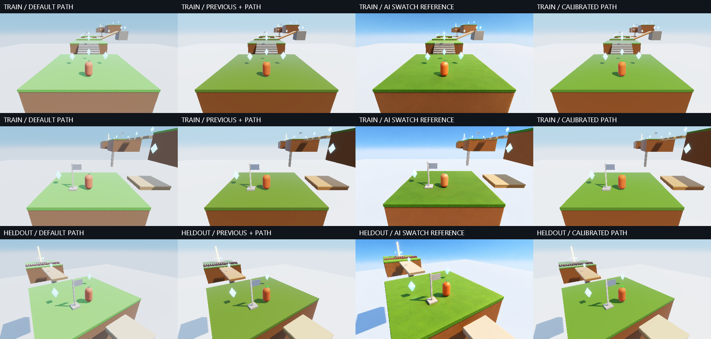

# Calibrating Cloudstep with PathDiffuse fixed

The third trial keeps Aurelian's **PathDiffuse fixed** and fits ordinary palette, ambient light, sun intensity, exposure and output controls. The selected Vulkan profile passes the declared calibration criteria: **22.17% lower training error and 27.15% lower fresh-reference error** than the previous calibration with PathDiffuse substituted. All four fresh-view material groups improve over the uncalibrated PathDiffuse default, with zero measured foreground clipping in the selected stills.

The methodological change is independent material sampling. We label interior hero, grass, earth and structure samples in each AI image separately from the renderer's semantic masks. We compare their color/tone distributions, not corresponding screen pixels. This removes the registration blocker from the [previous trial](image-guided-look-refinement.md) for this **coarse art-direction objective**. It does not qualify registered relighting, spatial shadow agreement, texture fidelity or perceptual realism.



## Default and compatibility

`Graphics3DSettings.Default` and newly constructed shaded settings now select PathDiffuse. Lambert, Burley, Frostbite and EON remain explicit options. `Graphics3DSettings.Basic` retains its existing Lambert selector and unlit diagnostic behavior. The diffuse comparison lab still starts from its deliberate Lambert control.

Published static-diffuse lighting assets have a Lambert-only transport contract. Beacon's two asset-loading entry points now select Lambert explicitly when that asset path is requested. Ordinary Beacon and Cloudstep launches use PathDiffuse. The renderer's rejection of incompatible published lighting remains intact; this trial does not rebake transfer assets for another lobe. Historical research harnesses explicitly pin their Lambert baselines, preserving their original comparisons.

The **new calibrated palette remains opt-in**. There is no runtime inference, dynamic diffuse-model arbitration, generated-image overlay, new geometry or target texture in the game. Conversion uses the existing cached `CloudstepLookProfile` presentation path, and rendering uses the production Vulkan renderer and existing shaders.

## Admission before fitting

The two earlier images, checkpoint 0 and checkpoint 1, are explicitly training references. A fresh built-in imagegen edit provides a new reference for the checkpoint-2 camera used in the failed second trial. The camera has been inspected before; its new target is held out from this optimization, not an entirely unseen scene or an independent human evaluation.

The edit uses the historical native checkpoint-2 capture as its layout input and the first pilot's training image only as an appearance reference. The exact [prompt](assets/look-calibration/heldout-prompt.txt), [new reference](assets/look-calibration/heldout-target.png), [review](assets/look-calibration/reference-review.json), annotations, protocol and hashes are retained. Built-in imagegen was used; no CLI/API fallback or correction generation was needed. The image still shifts the layout. It is admitted only as an independently sampled material reference.

Reference polygons are manually chosen by Codex before fitting, using coordinates at 960×540. They are interior swatches, **not dense semantic segmentation**. Hero samples exclude the leaf; emissive diamonds and sky are excluded. The fourth group combines pale stone, wood and flag samples, so it has greater material-mixture ambiguity. Each group needs at least 60 interior samples after four-pixel erosion and sampling every second pixel.

A pre-fit patch-color inspection found grass/bridge contamination in the initial fresh-view earth polygon. That polygon was narrowed and admission repeated **before any profile scoring**. Admission revision 2 records this correction; the initial lock is retained locally. There was no score-driven relabelling or target replacement.

Three controls pass exactly for every reference: self-comparison is zero, perturbing unlabelled background is zero, and translating both the reference and its labels eight pixels produces zero change. The last control directly checks the intended independence from absolute image position. The [admission record](assets/look-calibration/admission.json) retains sample counts and controls. Frozen hashes cover target images, source masks, reference patches, protocol, review and the prior profile used to seed fitting. Any change rejects fitting; an existing selection cannot be overwritten by another fit.

After selection, source-mask inspection found that omitting model-material objects from the label draw exposed the floor labels behind diamonds. Future captures now draw excluded objects with label zero while retaining their depth occlusion. The original masks, input lock and primary results are preserved. A separate [fixed-policy occlusion confirmation](assets/look-calibration/occlusion-confirmation.json) rescores all three views with corrected masks, without search or reranking: **22.70% training and 27.58% fresh-reference improvement**, with all criteria still passing. This is a post-selection robustness check, not another independent trial.

## Objective and bounded search

Each source material receives equal weight. For each, we calculate mean per-pixel D65 Lab and marginal Lab quantiles at 10%, 25%, 50%, 75% and 90%. Region error is half the mean-color Euclidean distance plus half the RMS quantile-vector distance; the objective averages the four regions. Lab uses every second interior pixel. The clipping gate checks **every** admitted interior pixel, counting RGB output bytes at least 254.

This objective captures coarse hue, lightness and tonal spread while tolerating camera displacement. It discards spatial arrangement and cross-channel distribution correlations. Different normals, shadow proportions, texture and author-selected samples can still confound comparisons. It is an aesthetic calibration proxy, not an inverse-rendering solution or a validated human preference metric.

The [protocol](assets/look-calibration/protocol.json) freezes PathDiffuse, palette decode and gamut compression. The coarse grid varies sky ambient, ground ambient, sun intensity, exposure and retention across 108 profiles using the prior palette. The prior fixed-Path profile is another seed. Three coordinate-refinement passes on the best two seeds additionally vary nine palette components. The budget is 360 unique profiles; **269 were evaluated**.

Training eligibility requires clipped-channel fractions at most 0.1% in both views. Five finalists receive 30 rotating GPU-frame samples after five warmup cycles. The time gate is `default * 1.25 + 0.15 ms`. Deterministic minimum error chooses the profile. Selection JSON and the live profile are saved before the fresh reference enters the scoring path; the profile hash must remain unchanged afterward.

The success thresholds are at least 10% training and 5% fresh-reference improvement over the previous calibrated profile with PathDiffuse substituted; every fresh-view group must also improve over the uncalibrated PathDiffuse default, with clipping at most 0.1%. All criteria pass. There is no fitted neural model or softmax requirement in this round.

## Results

| Control or policy | Mean training error |
| --- | ---: |
| Historical uncalibrated Lambert | 27.2502 |
| Current uncalibrated PathDiffuse | 25.4490 |
| PathDiffuse with palette decode only | 19.7900 |
| Previous calibrated Lambert | 9.5663 |
| Previous calibration with PathDiffuse substituted | 9.9881 |
| New calibrated PathDiffuse | **7.7736** |

The new metric differs from the earlier trials; compare these values only within this round. The selected profile also improves the mean training proxy over the prior Lambert winner, but this is not a fair diffuse-model ranking: only PathDiffuse received this round's optimization.

| Fresh-camera group | Default PathDiffuse | Previous + PathDiffuse | New PathDiffuse |
| --- | ---: | ---: | ---: |
| Hero | 39.277 | 15.882 | **11.430** |
| Grass | 34.610 | 15.283 | **8.569** |
| Earth | 30.599 | 20.269 | **15.075** |
| Structure | 12.876 | 10.960 | **10.383** |
| Equal-weight mean | 29.3403 | 15.5988 | **11.3643** |

Both training-view means improve. One training material tradeoff remains: camera-0 earth error rises from 1.793 to 4.158 versus the previous calibration, while camera-1 earth improves from 19.903 to 14.891. The objective balances views; it does not guarantee every training material improves separately.

The [selected profile](assets/look-calibration/selected-profile.json) uses sky ambient scale 0.74219, ground ambient scale **1.5, at the search bound**, sun scale 1.07788, exposure 1.2 and retention zero. It retains soft gamut compression and linear palette decode. RGB multipliers are grass `(1.52959, 0.57695, 0.29376)`, earth `(1.31653, 1.34986, 0.68729)`, hero `(0.95123, 1.64872, 0.57695)`. These values apply to this source palette and lighting; do not transplant them as universal material values. The active ground bound is evidence of a constrained fit, not proof that the global optimum was found.

At 960×540 on the local RTX 3070, GPU-frame medians were **1.148608 ms default, 1.155680 ms previous + PathDiffuse, 1.156736 ms selected**: about 0.7% above default. These local timings exclude CPU palette/presentation work and are not a portable performance or statistical significance claim.

Nine post-selection sun/exposure stress captures again reveal limited illumination robustness. Clipping reaches **0.421% at 2× exposure and 2× sun**, exceeding the normal calibration gate. The profile matches broad material colors better but still lacks the target's spatial variation, softer contact treatment and background appearance. Sky and cloud colors are outside the objective. More cameras, lighting conditions, label reviewers and human comparisons would be needed for a broader visual-quality claim.

## Native validation and replay

The [qualification ledger](assets/look-calibration/qualification.json) records the full Release build/test results, native numerical checks, published-lighting compatibility proof and exact game-replay agreement. The [evidence](assets/look-calibration/evidence.json) retains every searched profile, controls, comparisons, stress results, timestamps and reference hashes. Still fitting disables temporal AA; the exported live profile restores it.

The full Release build passes with zero warnings. **1,519 tests across 33 assemblies** pass with no failures or skips. Native checks pass 1,500 diffuse cases, 240 output-curve cases and three VTS utility scenarios. The published Lambert-lighting proof also passes its asset reload/fallback checks and four 64×64 decoder probes. Both complete 35-step native Cloudstep tours finish with zero falls and nine gems at tick 2,082; all **420 simulation-field comparisons match**. Live game captures retain temporal AA. These checks verify execution and bounded invariants, not human visual preference.

The published-lighting proof initially failed its repeat-frame hash check because temporal AA evolved between still captures. Its transport probes now explicitly disable AA before comparing bytes. This changes the diagnostic's temporal conditions, not the live renderer or asset equations; the initial failure log is retained locally.

Play the selected profile:

```powershell
.\cloudstep.cmd --look-profile docs/Aurelian/assets/look-calibration/selected-profile.json
```

Reproduce the frozen historical capture/admission/search, then verify corrected occlusion, in a new directory:

```powershell
dotnet build Aurelian.slnx -c Release -m:1 -nr:false -p:UseSharedCompilation=false
dotnet run --project tools/Aurelian.GraphicsProof -c Release --no-build -- --look-calibration --output artifacts/local/calibration-replay
Copy-Item docs/Aurelian/assets/look-calibration/heldout-target.png artifacts/local/calibration-replay/
Copy-Item docs/Aurelian/assets/look-calibration/*-patches.json artifacts/local/calibration-replay/
Copy-Item docs/Aurelian/assets/look-calibration/reference-review.json artifacts/local/calibration-replay/
# Restore the original frozen protocol and source masks for exact historical fitting.
# Fresh captures otherwise use the corrected occlusion masks by default.
Copy-Item docs/Aurelian/assets/look-calibration/protocol.json artifacts/local/calibration-replay/
Copy-Item docs/Aurelian/assets/look-calibration/*-regions.png artifacts/local/calibration-replay/
dotnet run --project tools/Aurelian.GraphicsProof -c Release --no-build -- --look-calibration --admit --output artifacts/local/calibration-replay
dotnet run --project tools/Aurelian.GraphicsProof -c Release --no-build -- --look-calibration --fit --output artifacts/local/calibration-replay
dotnet run --project tools/Aurelian.GraphicsProof -c Release --no-build -- --look-calibration --verify-occlusion --output artifacts/local/calibration-replay
```

The capture stage copies the two original training targets and the frozen previous profile from their repository fixtures. Keep all three trials' fixtures together. Regenerating the prompt does not reproduce the saved reference deterministically. Complete native tours, stress captures and full build/test logs remain under `artifacts/local/look-calibration*`.

The [replay verification](assets/look-calibration/replay-verification.json) executed this complete sequence: the selected profile hash and primary scores reproduce exactly, and fresh captures match the corrected occlusion masks. Deliberately changing a reference is rejected by the input lock, and refitting an already frozen selection is rejected. Neither negative check altered the original experiment.
