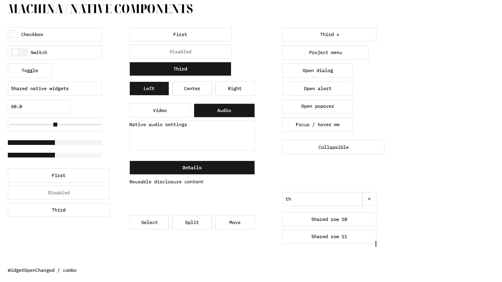

# Native controlled widgets

`Machina.Standard.Widgets` supplies reusable interaction behavior and styling over
the existing Machina nodes, actions, layout and presentation stack. It is native
C# targeting .NET 10, consumable by .NET 11 applications. Aurelian presents the
same Machina frame through Vulkan. No React, DOM, browser, npm or JavaScript
runtime is involved.

This is a first implemented component set, **not complete Base UI parity**.
Existing `StandardUI` APIs remain compatible. Prefer the controlled widget API
when you need editing, keyboard navigation, focus, capture or popups rather than
just static component declarations.

## Ownership and integration

- `Machina.Core`: nodes, typed actions and semantic metadata. Existing constructor
  arguments and role numeric values are preserved; new metadata/roles are additive.
- `Machina.Standard`: controlled component declarations and `WidgetSession`.
- `Machina.Runtime`: existing scope lifetime/input contracts and clipped hit tests.
- `Machina.Pipeline`: `MachinaWidgetPipeline` extends the existing preparation
  pipeline with current-layout overlay placement. It is not another layout engine.
- `Aurelian.Machina.Graphics`: `AurelianWidgetInput` transports native Silk input
  and supplies clipboard/capture. Its only added package is the centrally pinned
  `Silk.NET.Input` 2.23.0.

Own one disposable session per native window on its UI thread. Keep IDs stable.
Build a view, prepare it, send native input to the session, apply returned typed
proposals to the host model, then rebuild when interaction/model/size changes.
Reuse the prepared presentation during idle frames. The declaration callback must
be pure: overlays and focus visibility can require more than one layout pass.

```csharp
using Machina.Core.Authoring;
using Machina.Pipeline;
using Machina.Standard.Widgets;

using var session = new WidgetSession();
var pipeline = new MachinaWidgetPipeline();
bool enabled = false;

var frame = pipeline.Prepare(session,
    widgets => UI.Surface(children:
    [
        widgets.Checkbox("export.audio", "Include audio", enabled),
    ]), 1280, 720);

// In the native event loop:
// WidgetInputResult result = session.Handle(inputEvent, monotonicElapsed);
// foreach (var change in result.Changes)
//     if (change is WidgetCheckedChanged checkedChange)
//         enabled = checkedChange.Checked;
// nativeInput.SetPointerCapture(result.CapturePointer);
// Reprepare after applying proposals, including ones from session.DrainChanges().
// renderer.UpdateUi(frame.PresentationFrame);
```

Use native font measurement through `UiLoweringOptions` for both layout and
caret/popup geometry. An unconfigured pipeline uses deterministic test measurement.
Supply explicit foreground colors for arbitrary `UI.Text` content: generic node
defaults do not inherit the widget palette. `WidgetStyle` provides shared color,
size and spacing tokens; existing Standard theme tokens supply the defaults.

Host-side application edits still go through the application's command dispatcher.
Widgets never mutate a saved document. `WidgetChange.Action` retains an optional
typed application action; change payloads carry the proposed controlled value.
Apply slider Preview transiently, Commit once, and Cancel by restoring the gesture
start value. Never append one application undo operation per pointer move.

Route input through the widget session before application shortcuts. If
`Handled` is true, do not send the same key to InputMan or an application command
handler. This keeps local text undo/delete and popup navigation from also editing
the timeline underneath. A native host must still deliver focus/capture loss and
resize events even when another application subsystem handles ordinary input.

## Implemented coverage

| Family | Current native behavior | Deliberate limits |
|---|---|---|
| Button | Pointer activation on matching release, Enter, Space on release, disabled occlusion, focus ring | No arbitrary browser prop/event API |
| Checkbox, Checkbox Group, Switch, Toggle, Toggle Group | Controlled values, mixed checkbox indicator, square/round group indicators, read-only/disabled states, single/multiple selection, keyboard interaction, ellipsized labels | Toggle group items use button visuals by design |
| Input | Single-line Unicode, grapheme caret/deletion, pointer and double/triple-click selection, Windows-style Ctrl word movement/deletion, horizontal text scrolling, Home/End (and Up/Down), select all, clipboard (line breaks pasted as spaces), bounded local undo/redo | Committed Unicode only; no IME preedit, bidi editor or multiline input |
| Number Field | Invariant decimal draft, explicit commit/failure, bounds/step, arrow/page changes; a clamped or unchanged commit redisplays the committed value; values display without scale noise (`50`, not `50.0`) | No locale formatting, wheel spin or scrub handle |
| Slider | Exact decimal range/step, horizontal/vertical/RTL, pointer capture, Preview/Commit/Cancel, keyboard | One thumb; no range slider |
| Radio Group | Roving tab stop, arrows/Home/End, disabled skipping, looping, automatic selection, RTL | Fixed option declarations |
| Tabs | Manual/automatic activation, roving focus, orientation/RTL, selected panel only | Vertical tab list is above content; no animation |
| Toolbar | Roving focus; invocation reports the item via `WidgetInvoked.Key` | Flat button toolbar |
| Accordion, Collapsible | Controlled disclosure, expanded/controls semantics, disabled headers, accordion arrows, individual header Tab stops | Fixed content height; no animated measurement |
| Select | Stable keys, current selected option, arrows/Home/End/typeahead, scroll-into-view, selection/dismissal, trigger focus restoration | Single selection, nonvirtualized options |
| Combobox | Controlled query separate from selected key, deterministic filtering, suggestions, arrows/Enter/Escape, empty results; clicking its input while open edits instead of dismissing; typing with an option focused returns to the query | Single selection, no tokens or async search provider; host decides selected-label text |
| Menu | Flat menu items, keyboard/typeahead, dismissal, invocation represented by selected item key | No submenus, menubar or context-menu positioning |
| Dialog, Alert Dialog | Current-geometry overlay, nested popup focus scope, focus trap/restore, Escape, explicit close, outside-click policy | Alert blocks outside dismissal but permits Escape; no native window dialog |
| Popover, Tooltip | Anchor flip/clamp, overlay clipping, Escape, outside-click consumption for popovers, focus moves into popover content and returns to the trigger; tooltip hover/focus and dismissal suppression | Tooltip is immediate unless caller supplies controlled timing; no hover grace corridor; Tab does not return from popover content to the trigger's next sibling |
| Scroll Area | Vertical wheel/keyboard scroll, clipped hit testing, focus ring drawn above content, indicator in its own 8 px gutter (`ScrollbarGutter`), focus visibility | No thumb drag, horizontal scroll or virtualization |
| Progress, Meter, Separator | Controlled values/semantics and native primitives | Indeterminate progress has a static marker, not an animation |
| Field, Fieldset, Form | Label/description/error relationships, grouped declarations, validation state metadata | Validation/business rules and submit remain application-owned |

Not implemented in this increment: Avatar loading/fallback lifecycle, separate
Autocomplete API, Context Menu, Drawer, Menubar, Navigation Menu, OTP Field,
Preview Card, Toast lifecycle. `WidgetPopupKind.Drawer` is reserved, not a working
drawer implementation. Do not advertise these as available components.

Semantic metadata is **not an OS accessibility bridge**. UI Automation/screen
reader integration and IME composition require separate native host work. Current
keyboard behavior and semantic tests do not qualify those missing capabilities.

## Keyboard scope and application shortcuts

`WidgetSession.KeyboardScope` reports the keyboard policy the widgets need: `TextEntry` (a text or number field
owns unmodified keys), `Popup` (navigation/Escape belong to the open popup), `Modal` (every key belongs to the
dialog), `Control` (a non-text widget has focus) or `None`. Map it onto the application's shortcut system, for
example by pushing an InputMan action map per scope, so shortcut policy stays in one declarative place.
`WidgetInputResult.Handled` remains authoritative per event and agrees with the scope.

## Interaction rules

- Controlled values stay in the host. Rejected changes leave the authoritative
  application model untouched; the next declaration resynchronizes text.
- Text limits count UTF-16 units; insertion preserves the suffix and avoids cutting
  surrogate pairs. Caret movement/deletion uses .NET grapheme boundaries. Local
  input history is capped at 64 snapshots and is independent of application undo.
- Numeric values use `decimal`; step snapping is relative to the minimum, with
  halfway values rounded upward in that nonnegative offset. Conversions through
  `double` are limited to pointer position/visual fraction, not model values.
- A focused text field consumes every key without Ctrl/Meta/Alt (typing "i" never also runs an application's
  Mark In); command chords pass through. Auto-repeated Enter/Space on a focused control are consumed but do not
  activate again. While a modal is open, keys, text and wheel input never reach the application.
- Keyboard focus and the text draft survive window deactivation; gestures, hover, armed keys and typeahead do not.
- Secondary/middle clicks never activate widgets; on an overlay they are consumed and outside clicks dismiss.
- Labels are ellipsized to their control (accessible names keep the full text). An overflowing row is a layout
  error in Machina, so no widget lets a label exceed its slot.
- Ordinary controls activate on matching pointer release. Disabled controls block
  hits to controls behind them. Capture/focus loss cancels gestures and clears
  armed keys. Resize cancels capture before new geometry is prepared.
- Popup order follows resolved overlay order, including nested declarations.
  Escape closes the top dismissible popup; an outside click is consumed and never
  also activates a covered control. Menus/selects dismiss on Tab and move onward.
- Modal focus includes descendant overlays such as a select opened inside a dialog.
  Closing nested overlays restores surviving focus without resurrecting removed
  nodes. Alert dialogs ignore outside dismissal.
- At most 16 popups are active in one view. Popup geometry uses current layout,
  not the previous frame. At most one extra full declaration/layout corrects an
  initially offscreen selected option. Scroll state is pruned when regions unmount.
- `AurelianWidgetInput` coalesces adjacent motion events, caps its queue at 4096,
  and suspends input on overflow/callback failure. Native callbacks queue facts;
  they do not invoke application commands, layout or Vulkan. Poll, handle,
  prepare and render on the window thread. Dispose input before the window.
- Clipboard failure is `WidgetOperationFailed`, not a silently successful paste.
  Invalid declarations/duplicate IDs remain programmer errors with diagnostics.

## Base UI reference and attribution

Behavior was compared with [Base UI](https://base-ui.com/react/overview/about),
pinned to [mui/base-ui commit 6dd2a6987b3a01d000da6745a45f4690941e7a13](https://github.com/mui/base-ui/tree/6dd2a6987b3a01d000da6745a45f4690941e7a13).
Reviewed implementations under `packages/react/src/` include
`tabs/root/TabsRoot.tsx`, `dialog/root/useDialogRoot.ts`,
`select/root/SelectRoot.tsx`, `slider/root/SliderRoot.tsx`,
`radio-group/RadioGroup.tsx`, `checkbox/root/CheckboxRoot.tsx`, and
`toolbar/root/ToolbarRoot.tsx`.

The harvest is interaction intent: controlled state, navigation, disabled
registration, popup lifecycle and commit boundaries. The C# implementation uses
Machina's own authority; JS/React implementation code is not included. The
reference's [MIT copyright/license notice](reference/base-ui-LICENSE.txt) is
retained. This does not change the repository's license or imply Base UI API or
accessibility conformance.

## Validation and native gallery

The concrete native consumer is Valencia's `NativeWidgetGallery`, a thin host over
this library using its existing `NativeVideoPresenter` and Aurelian Vulkan path.
It does not add Valencia dependencies to Machina.

```powershell
# Copeland
dotnet test Machina.UI.slnx -c Release -m:1 -nr:false -p:UseSharedCompilation=false
dotnet test tests/Integrations/Aurelian.Machina.Tests -c Release -m:1 -nr:false -p:UseSharedCompilation=false

# ValenciaNLE
dotnet test Valencia.slnx -c Release -m:1 -nr:false -p:UseSharedCompilation=false
dotnet publish src/Valencia.App -c Release -r win-x64 --self-contained false -o artifacts/local/native-widgets-host -m:1 -nr:false -p:UseSharedCompilation=false
./artifacts/local/native-widgets-host/Valencia.App.exe --widget-gallery
./artifacts/local/native-widgets-host/Valencia.App.exe --widgets-smoke --output artifacts/local/native-widgets-smoke
```

Recorded results and limitations are in [validation/native-widgets.json](validation/native-widgets.json).

2026-11-17 hardening: `WidgetHardeningTests` adds 23 regression cases for the defects fixed in that pass and a
seeded randomized interaction test (4 seeds x 2,500 mixed key/text/pointer/wheel/focus/resize events over a full
controlled view) asserting no exceptions, focus only on mounted nodes and no capture leaks, with a guard that
popups, text edits and numeric commits were actually exercised. Machina.UI solution: 867 passed.
Current-source Release validation on the Ryzen 7 7700X / RTX 3070 (driver 610.88):

| Check | Observed result |
|---|---|
| Machina fast solution | 840 passed |
| Aurelian integration | 70 passed |
| Valencia regression | 300 passed |
| Added cases | 33 widget/pipeline interactions and 17 native key mappings |
| Native gallery | 27 scripted stages, 17 named checks; real native WM_CHAR transport |
| Vulkan validation | Available and enabled; zero captured errors |
| Idle native draw CPU wall time, 120 samples | p50 5.47 ms, p95 5.91 ms, p99 6.03 ms, max 6.37 ms |
| Full draw sample including startup/resize | p99 54.16 ms, max 59.84 ms; not hidden in idle numbers |
| First preparation | 2,493 ms cold; subsequent individual values retained in JSON |
| 1,000 checkbox declaration rebuild | Six CPU-only samples, approximately 37–97 ms; not a virtualization or GPU benchmark |
| Existing editor/export smoke | Passed, max observed A/V skew 45.23 ms; independent FFmpeg verified cuts, source order, black/silent gaps and H.264/AAC output |

All 1,210 automated cases passed with zero failed/skipped. Native draw numbers
include submission/presentation waits; they are not GPU execution or
input-to-visible latency. Cold preparation and nonvirtualized large lists remain
performance limitations, not completed optimizations.

The RTX 3070 smoke uses application-owned GPU readback, not screen recording.
Posted Windows character messages exercise real Silk text callbacks; scripted
pointer/key sequences exercise the shared session. Physical pointer/keyboard,
screen readers, full IME, device hotplug and other operating systems remain
unqualified. Interactive gallery mode is available for those manual checks.


