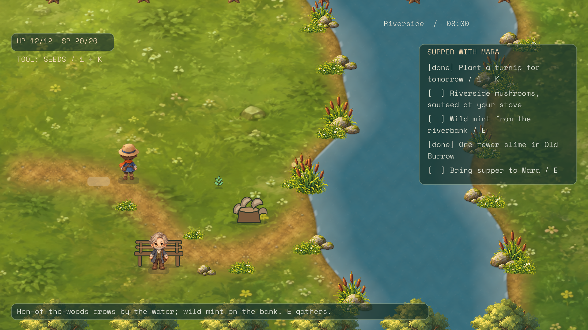
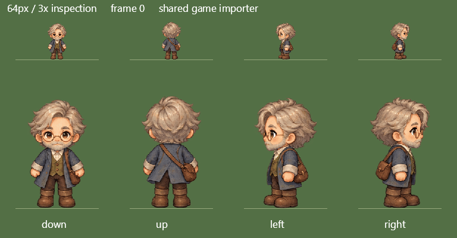
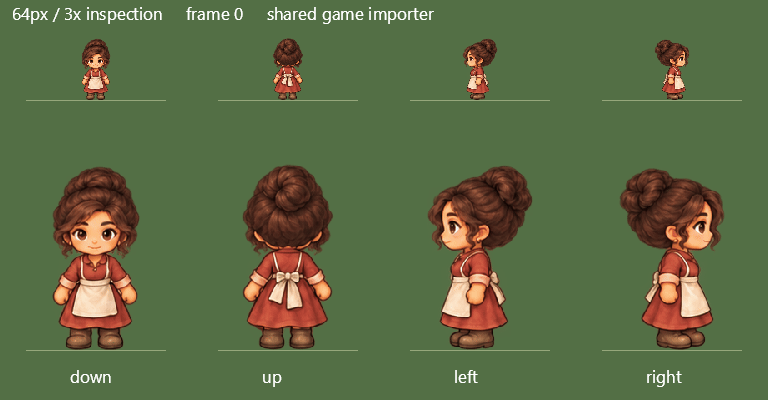

# TinyFarm: shared character art for the cast

Elias and Sela now use painted four-direction walk sheets generated from the
[Gardener-derived blank template](assets/tinyfarm-characters/blank-walk-template-v2.png). Gardener has a portrait
derived from the existing Gardener sprite, and Elias and Sela each have a portrait derived from their new sheet.
Mara retains the previously selected sheet and portrait. All four portraits appear in the existing agent panel:
press **C**, then use the left/right arrows or **Agent** buttons to inspect each character.



## Character identity and control

Every character agent is potentially playable. Identity, appearance, inventory, skills and world position belong
to that character. Human, scheduled and idle control describe how the character receives decisions. A future
GTA/Sims-style switch or internally named possession mechanic should change control of the actor while preserving
the actor's identity and owned state. Inspecting another agent in the current panel changes only the inspected
identity; it does not switch control.

This pass prepares art for that model. Existing `actor.elias` and `actor.sela` art slots select sheets by actor ID.
`TinyFarmCharacterPortraits` selects portraits by actor ID or the already-existing authored
`Appearance.ConversationSprite` key, without selecting a different face for Human, Schedule or Idle control.
Unknown keys produce no portrait, and object agents do not borrow a character face. The current Gardener still has
the legacy actor ID `player` and display name `You`; that ID is its current identity binding, not a promise to move
other characters into that slot when switching is designed.

`TinyFarmPortrait` now presents the inspected character in a reserved agent-panel header square, or the speaking
actor beside a dialogue panel. The portrait layer is above the UI layer so the opaque agent panel cannot cover it.
The dialogue coordinator still implements Mara's existing conversation; this pass does not create Elias/Sela
dialogues or implement character switching. Existing player-specific gameplay, camera and combat code still needs
design work before control can actually move between characters.

## Assets and generation

| Character | Walk sheet | Portrait |
| --- | --- | --- |
| Gardener | Existing `Assets/GateA/gardener.png` | `Assets/characters/gardener-v1/portrait.png` |
| Mara | Existing `Assets/characters/mara-v1/walk-sheet.png` | Existing `Assets/characters/mara-v1/portrait.png` |
| Elias | `Assets/characters/elias-v1/walk-sheet.png` | `Assets/characters/elias-v1/portrait.png` |
| Sela | `Assets/characters/sela-v1/walk-sheet.png` | `Assets/characters/sela-v1/portrait.png` |

Asset paths in the table are relative to `Games/TinyFarm/TinyFarm/`. New artwork used the **built-in image
generator**, with exact [prompts and input roles](assets/tinyfarm-cast/prompts.json) retained. Elias follows the existing
scholar brief (grey-blond hair, blue-grey coat, book satchel), with glasses and a short beard. Sela follows the
existing shopkeeper brief (dark bun, brick-red dress, cream apron). The Gardener portrait preserves the straw hat,
blue coat and orange scarf from the selected sprite rather than inventing a separate protagonist.

Sela's first sheet touched a cell boundary and failed geometry review. A layout-only generation correction reduced
the figures and widened the gutters. Both selected sheets pass the shared game importer with sixteen nonempty cells
and a minimum three-pixel margin. No manual repainting or silent removal of pixels was used. The exporter renders
the game import metadata at 64-pixel height and at 3× inspection scale:





As in the Mara trial, the sheet is generated artwork, not a rig with mathematically constrained joints. Small
silhouette and clothing variations remain, and some stride phases remain visually similar. Geometry passing does
not certify anatomical or animation quality. Native views and the looping previews are retained for aesthetic
review. Source-file SHA-256 checks pin the selected sheets through the art-slot manifest and portraits through the
portrait catalog.

## Verification

```powershell
dotnet build TinyFarm.slnx -c Release -m:1 -nr:false -p:UseSharedCompilation=false
dotnet test TinyFarm.slnx -c Release --no-build -m:1 -nr:false
dotnet tools/Aurelian.ArtSlots/bin/Release/net10.0/Aurelian.ArtSlots.dll review-sheet Games/TinyFarm/TinyFarm/Assets/characters/elias-v1/walk-sheet.png --out artifacts/local/tinyfarm-cast/elias
dotnet tools/Aurelian.ArtSlots/bin/Release/net10.0/Aurelian.ArtSlots.dll review-sheet Games/TinyFarm/TinyFarm/Assets/characters/sela-v1/walk-sheet.png --out artifacts/local/tinyfarm-cast/sela
dotnet Games/TinyFarm/TinyFarm/bin/Release/net10.0/TinyFarm.dll --playtest-script Games/TinyFarm/Playtests/cast-native.json --output artifacts/local/tinyfarm-cast/native-final --save-root artifacts/local/tinyfarm-cast/native-final/saves
```

The final solution build passed with zero warnings/errors; all **447 tests** passed (420 TinyFarm, 27 Spatial2D).
New tests load the real pinned portraits and check identity preservation across controller roles, authored portrait
overrides, unknown/object rejection and agent-panel inspection without semantic-world changes. The first build also
reported fourteen existing OpenFont third-party warnings; the final incremental build was clean.

All **37 native script steps** passed with no errors on an RTX 3070 at 1920 × 1080. Results and screenshots are
recorded in [provenance](assets/tinyfarm-cast/provenance.json).
The script visits all four portraits, checks that the shipping chest has no face, revisits Mara's actual dialogue
and reaches Elias at Riverside. It does not exercise Sela walking in the normally closed General Store, nor does it
claim control transfer. All sixteen Sela frames are exercised by the shared-import preview.

The initial native attempt asserted immediately after a menu click, before the click was consumed at the next fixed
tick. Its failed trace is under `artifacts/local/tinyfarm-cast/native/`; the corrected script waits for the ordinary
input cadence. Full logs, traces, captures and the rejected Sela sheet are under `artifacts/local/tinyfarm-cast/`.
