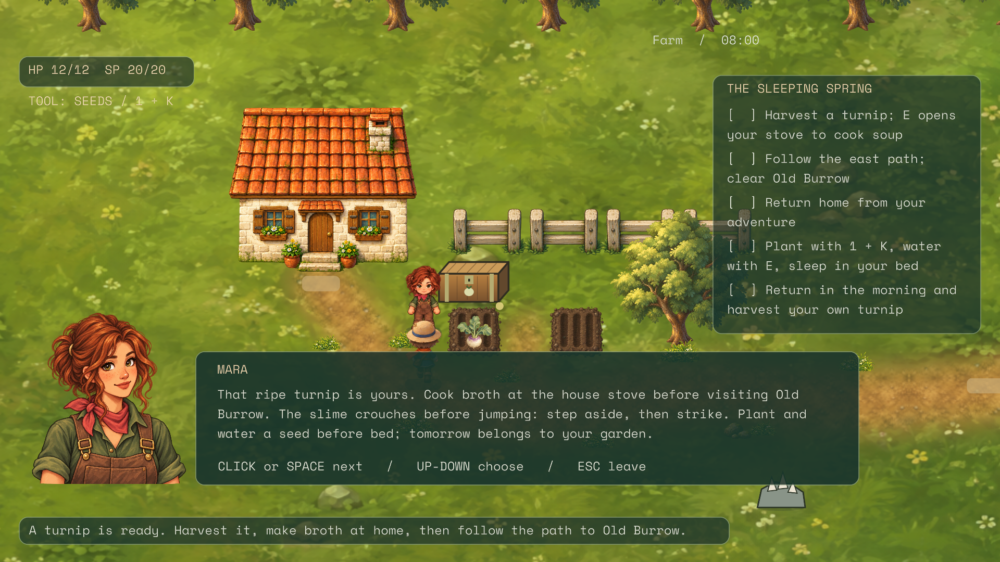
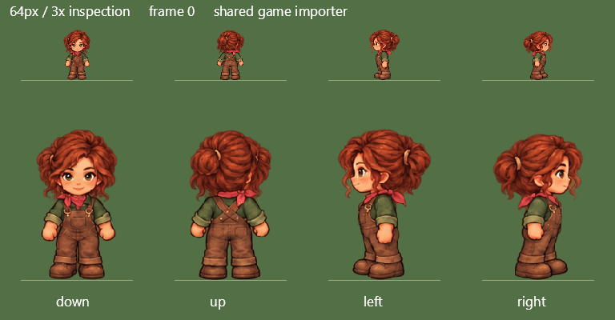

# TinyFarm: template-guided character sprites

The follow-up [cast art pass](tinyfarm-cast-art-pass.md) applies this template to Elias and Sela and adds identity
portraits for all four characters, including Gardener. The original Mara trial and its evidence are retained below.

Mara now uses a painted 4 × 4 walk sheet and a matching dialogue portrait. Her earlier portrait supplies the identity:
auburn loose bun, freckles, hazel eyes, red kerchief, olive shirt and brown bib overalls. The Gardener supplies the
camera, compact proportions, painted style and row order. Both new runtime images are versioned under
`Games/TinyFarm/TinyFarm/Assets/characters/mara-v1/` and checked against source-file SHA-256 hashes when loaded.



## Reusable layout

Start with [the blank template](assets/tinyfarm-characters/blank-walk-template-v2.png), not a character turnaround.
It was generated from the actual Gardener sheet. It has no character identity; colored limbs help distinguish
opposite steps. The ivory background belongs to the guide and must disappear from finished sprites.

| Row | Facing | Columns |
| --- | --- | --- |
| 0 | Down / toward viewer | Idle, first step, passing, opposite step |
| 1 | Up / away | Same four phases |
| 2 | Left | Same four phases |
| 3 | Right | Same four phases |

The sheet is square with sixteen equal cells. The engine rounds grid edges once, so image dimensions need not be
divisible by four. Each cell must contain one complete figure with transparent space on every side. Ask for figures
no taller than about 68% of each cell and generous gutters; maximum visual occupancy is a poor generation target.
The importer trims alpha above 16, scales every frame uniformly so the tallest is 64 pixels at 48 pixels/metre,
and anchors each trimmed frame at its bottom centre. Template foot coordinates guide generation; they are not
exact pixel constraints enforced by diffusion.

## Generate, inspect, correct

1. Give the image generator three explicitly named inputs: blank template for layout/poses, a character reference
   for identity/clothing, and Gardener for style. Keep their roles separate. Request genuine transparent RGBA.
2. Generate the complete sheet. Check that every row retains its direction and that columns 1 and 3 show opposite
   legs and arms. Bilaterally similar clothing can conceal a duplicated stride. Color-coded guide limbs help expose
   that ambiguity but do not guarantee anatomical consistency in the output.
3. Import the sheet with the review command below. Inspect the game-size poses and looping animation as well as
   the full-resolution artwork. Reject empty cells, clipped figures, adjacent-cell fragments and opaque backgrounds.
4. Request a focused generation correction for the actual defect, then rerun import and visual review. A request
   to edit two cells can also repaint other cells: compare the whole result before accepting it. Wider gutters were
   necessary in this trial even after a layout template was supplied.
5. Generate the dialogue portrait from the selected sheet and identity reference. Check it alongside the world
   sprite in the native dialogue view, then pin both file hashes and retain prompts/provenance.

The complete [prompt sequence](assets/tinyfarm-characters/prompts.json) records inputs and selected/rejected outputs.
All artwork in this pass used the **built-in image generator**. No hand-painted replacement or API fallback was used.
The [layout recipe](assets/tinyfarm-characters/layout.json) records the import contract for the next character.

## Review command

From the repository root:

```powershell
dotnet build tools/Aurelian.ArtSlots -c Release -m:1 -nr:false -p:UseSharedCompilation=false
dotnet tools/Aurelian.ArtSlots/bin/Release/net10.0/Aurelian.ArtSlots.dll review-sheet Games/TinyFarm/TinyFarm/Assets/characters/mara-v1/walk-sheet.png --out artifacts/local/tinyfarm-characters/mara
ffmpeg -hide_banner -loglevel error -y -framerate 7.5 -i artifacts/local/tinyfarm-characters/mara/animation/%02d.png -vf "split[s0][s1];[s0]palettegen[p];[s1][p]paletteuse" -loop 0 artifacts/local/tinyfarm-characters/mara/walk-preview.gif
```

The existing ArtSlots tool now writes `sheet-review.json`, `poses.png` and four animation PNGs. It uses the actual
`Aurelian.GameWorld2D.GridSpriteSheet.Import` metadata, including runtime scale and pivots. The PNG preview uses Skia;
it is an import/motion inspection aid, not a Vulkan capture. The GIF plays the existing eight-tick frame cadence at
60 ticks/second. Its top row is 64-pixel scale; its lower row is magnified 3×.



The command returns failure for cells touching their boundaries or a sheet without fully transparent pixels. This
is a geometry gate only. Facing, opposite strides, identity, alpha-edge quality and animation still need visual
review. It does not repair, repaint or silently discard pixels.

For another authored NPC, use the existing `actor.<id>` art slot with `columns: 4`, `rows: 4`, a suitable
`worldHeight` (1.333 for a 64-pixel character at the base scale), `final` and `finalSha256`. The existing Gardener
presentation enum routes those actor slots; it does not require the Gardener's identity. Mara retains her existing
presentation enum and now uses the same walk-frame selection and grid importer. Simulation, NPC schedules and
collision do not derive from the generated image.

## What the trial established

The [first gray template](assets/tinyfarm-characters/blank-walk-template-v1.png) retained useful layout but also
white edge debris and ambiguous steps. Its [first Mara output](assets/tinyfarm-characters/mara-template-v1-trial.png)
carried the identity and all four directions, while repeating some stride poses. A repair of the gray template did
little to solve that ambiguity, so the second template used colored limbs and an opaque guide background.

The colored template, followed by a focused front/back stride correction, produced clearer opposite steps.
However, the resulting artwork still crossed equal row boundaries. The [rejected import preview](assets/tinyfarm-characters/rejected-tight-poses.png)
shows chopped heads and stray fragments; its [report](assets/tinyfarm-characters/rejected-tight-review.json) fails
with zero margin. Asking for smaller figures and wider gutters produced the selected sheet. Its
[report](assets/tinyfarm-characters/sheet-review.json) passes all sixteen cells with a minimum 15-pixel margin.

This is a useful authoring workflow, not an exact animation rig. There is still small frame-to-frame variation in
hair, folds and silhouettes, including bun placement in a repaired back-facing step. The animation preview is
available for aesthetic review; this pass does not claim artist-approved locomotion or automatically solved identity
consistency. The native walkthrough checks Mara's ordinary world pose and portrait; it does not exercise every NPC
walking direction. The full sheet is exercised by the shared-import preview.

Generation is cheap relative to manually painting the sprites. The useful tooling work is therefore selecting and
composing generated artwork, inspecting it at runtime scale, and making corrections without damaging accepted work.
A precise future correction tool should copy only selected candidate cells into an approved sheet, rather than
trusting a prompt to preserve all unrelated pixels. That composition operation was not needed to load this sheet
and is not implemented in this pass.

## Qualification

```powershell
dotnet build TinyFarm.slnx -c Release -m:1 -nr:false -p:UseSharedCompilation=false
dotnet test TinyFarm.slnx -c Release --no-build -m:1 -nr:false
dotnet Games/TinyFarm/TinyFarm/bin/Release/net10.0/TinyFarm.dll --playtest-script Games/TinyFarm/Playtests/characters-native.json --output artifacts/local/tinyfarm-characters/native --save-root artifacts/local/tinyfarm-characters/native/saves
```

The solution build passed with zero warnings/errors. All 444 tests passed (417 TinyFarm and 27 Spatial2D). The native
Vulkan walkthrough completed all ten steps with no script errors, including dialogue-active and dialogue-closed
assertions. Captures show the new world sprite and matching portrait through the ordinary game path on an RTX 3070
at 1920 × 1080. Full build/test logs and traces are under `artifacts/local/tinyfarm-characters/`; compact checked-in
evidence and provenance are beside this report.
