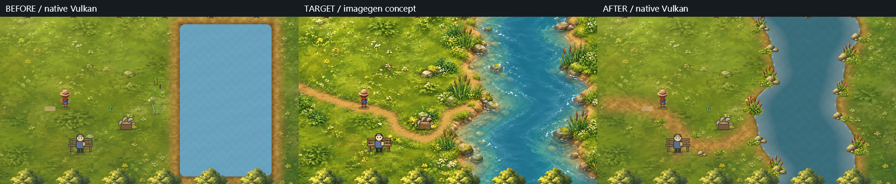
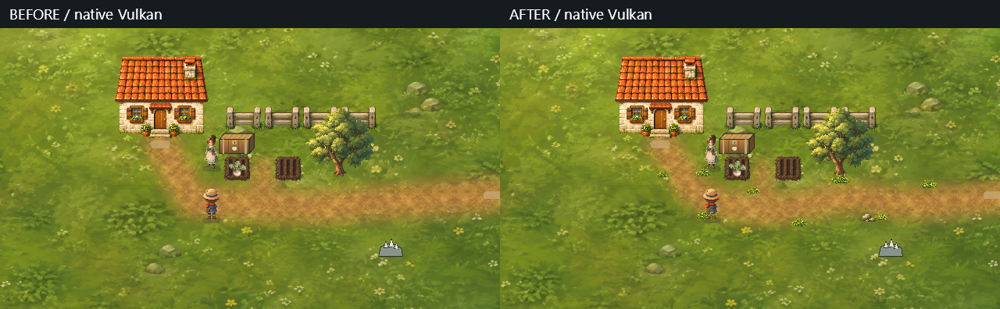

# TinyFarm: concept-guided shoreline and roads

The normal TinyFarm launch now uses multiscale ground with a meandering river, curved roads and separately composed painted clutter. `--terrain legacy|alpha|detail|multiscale` remains available for ground comparisons; all four now share the new authored river and live water presentation.

```powershell
.\Play-TinyFarm.cmd
```

## Concept to native rendering





The target was generated from the previous native Riverside screenshot with the camera, player scale and palette constrained. It replaces the closed pool with a river passing through the image, winding banks, exposed soil, clustered cattails, mossy stones and grass invading a narrow footpath. The built-in image generator then used that concept as the reference for three separate transparent sprites. These pass through the existing art-slot catalog, alpha trimming, hash checks and native sprite composition.

The concept is an art reference, never the game's background. The game still draws material ground, live water, props, actors and interface separately. No image generator or neural inference runs during play.

The result is visibly closer in river silhouette, path shape, water color and foliage/stone vocabulary. It is not a pixel reconstruction of the concept. The existing meadow remains more uniform, the water has simpler detail, the small sprite set repeats, and several NPC/forage/chest assets are still placeholders. This trial supports using concept art to guide geometry and a coherent asset family; it does not establish a perceptual score or prove that a blend operator solves overall art direction.

## Geometry owns the boundaries

`TinyFarmLandscape` in `TinyFarm.Core` owns the bank polylines and road centerlines. The banks are sampled at quarter-tile intervals from a broad meander plus a smaller irregularity. The river varies in width and continues beyond both vertical scene edges. Its polygon and the two meadow polygons feed the existing semantic navigation compiler. Roads use sampled Catmull–Rom curves and retain their logical entrances and destinations.

The runtime field now derives its domain from the same geometry. Its half-tile solver cells conservatively cover any intersecting water; gameplay membership uses the exact authored boundary. This lets a partially wet solver cell support waves without making its dry portion count as water for movement/contact effects. The fluid domain is 20 by 28 cells, covering the river and scene overscan.

`TinyFarmRiverProjection` interpolates the existing live height, foam and charge channels into a 220 by 300 presentation texture. Blue stores a signed bank offset from the shared geometry. Coverage and a shallow-water color treatment reconstruct that boundary, rather than exposing the coarse solver-cell outline. The offset is a horizontal bank-distance surrogate, not physical depth or a full fluid surface reconstruction.

The terrain compositor uses the same bank offset for soil, dampness and contact shading. It unions the bank material with the curved Riverside path. Reeds, grass and rocks are placed in small groups relative to those banks, with gaps and scale/mirror variation. Small clutter is decorative and does not invent navigation or collision from sprite bounds. The original semantic reeds object is dressed with the generated cattail sprite; its semantic role remains separate from the extra decorative copies.

## Authoring-time ground bake

Curved paths increased the cost of the initial synchronous compositor trial. The normal multiscale path now loads two checked-in ground PNGs. They contain material layers only; water and objects remain live. Geometry/material input hashes, explicit recipe revision, PNG hashes, decoded pixel hashes and expected dimensions are checked at load time. A stale bake fails with an authoring diagnostic rather than silently drawing the old shoreline.

For geometry, material or composition changes, rebuild the authoring tool, regenerate both maps, then rebuild to copy the new content:

```powershell
dotnet build Games/TinyFarm/TinyFarm -c Release -m:1 -nr:false -p:UseSharedCompilation=false
Games/TinyFarm/TinyFarm/bin/Release/net10.0/TinyFarm.exe --bake-terrain Games/TinyFarm/TinyFarm/Assets/shoreline/ground
dotnet build TinyFarm.slnx -c Release -m:1 -nr:false -p:UseSharedCompilation=false
dotnet test TinyFarm.slnx -c Release --no-build -m:1
```

When changing the composition algorithm itself, increment its recipe revision as well. The golden bake test recomposes both maps with the current code and requires exact decoded pixel equality. It also checks rejection of changed scene geometry. Four-world-unit ground overscan matches the existing meadow slab and avoids truncating the entry path at a cache boundary.

The final native default run loaded the Farm map in 32.15 ms and Riverside in 15.86 ms, rather than executing the compositor during play. These are single desktop observations, not total scene-load or frame-time benchmarks. The two derived maps retain 8,773,632 RGBA bytes, with GPU copies and other assets additional. Alpha and detail remain experimental synchronous controls.

## Persistence and verification

The water recipe is now `tinyfarm.riverside.stream.v2`. The explicit v1 migration verifies the old rectangle's topology, transfers dynamic channels by world position where the old and new domains overlap, and preserves tick, charged-water cooldown and contact counters. Newly wetted cells start from the new defaults. Malformed topology is rejected. This is an authored world edit, so the new field hash intentionally differs from the previous rectangular river.

The native material matrix uses the existing 12-step `terrain-study.json` walkthrough with separate save roots. The ordinary launch was used for its multiscale run to verify the new default. All 3,168 fact comparisons passed, including game and field hashes. The evidence comparison includes baseline self-checks. Source sprites, geometry and live-water presentation are held constant across modes.

`Playtests/shoreline-native.json` adds normal input movement along the bank into water, asserts `tinyfarm.wading` and `tinyfarm.water-disturbed`, swings the sword and captures the live field after movement. It completed all 17 steps. The initial direct approach did not reach water; its failed assertion is retained under `wading/`, while the final route and captures are under `wading-final/`.

This check also exposed an existing integration gap: `TinyFarmSession.AdvanceFieldTick` reduced the current chapter's slice tick and returned before advancing the fluid. It now advances the same existing field solver on that cadence. A current-chapter host regression requires six fluid ticks per 100 ms and verifies an energized field changes. No second simulation loop was added. Unit checks also cover polygon/gameplay agreement across the visible scene, conservative solver coverage, presentation membership and live channels, meander/width/open ends, save migration, and exact bake reconstruction.

The final TinyFarm build passed with no warnings/errors. All 444 solution tests passed (417 TinyFarm and 27 Spatial2D). One earlier run reported 1,216 bytes in the existing zero-allocation candidate-lookup test; its focused rerun and a complete solution rerun passed without changing that test or its owner. Both logs remain in the local evidence folder.

Build/test logs, full native captures and traces are under `artifacts/local/tinyfarm-shoreline/`; the final material matrix with the fluid-step fix is under `final-matrix/`. The compact retained evidence is [here](assets/tinyfarm-shoreline/qualification.json). The first capture with regular water glints and a truncated path remains under `first/` for comparison. The final shader uses sparse irregular highlights and a deeper blue-teal palette.

## Generated asset provenance

The concept, three transparent sprites, exact four prompts and hash provenance are in [Assets/shoreline](../../Games/TinyFarm/TinyFarm/Assets/shoreline/provenance.json). Generation used the built-in imagegen tool. Sprite PNGs are consumed through `Assets/art/art-slots.json`; the concept PNG is excluded from the runtime content copy. The baked ground files are deterministic renderer outputs, not additional generated scene art.

This is a Farm/Riverside art and layout slice. Overworld river dressing, a larger anti-repetition asset set, richer water flow, full placeholder replacement and arbitrary terrain editing remain outside it.
