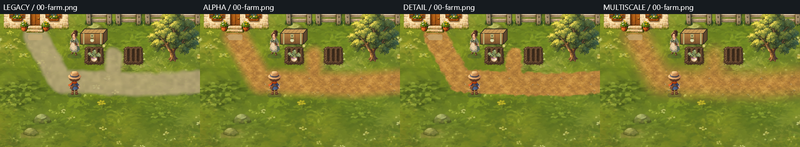
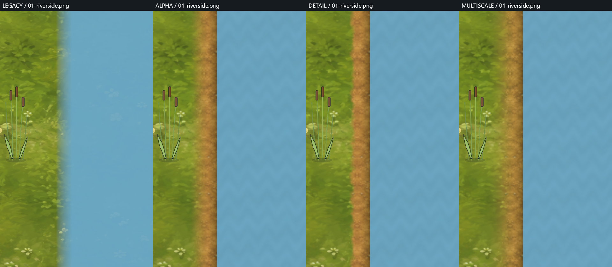

# TinyFarm terrain blending experiment

Historical first trial (`e4c6b034`). The [next shoreline trial](tinyfarm-natural-shoreline.md) changes the authored
geometry, adds concept-derived clutter and makes baked multiscale ground the normal launch. The results below
describe the original rectangular river and are retained as the comparison baseline.

This experiment adds three opt-in ground treatments to the actual TinyFarm game. It covers the Farm path and the Riverside bank, with native Vulkan screenshots from a fixed walkthrough. The normal launch still selects `legacy`.

```powershell
.\Play-TinyFarm.cmd --terrain multiscale
# Alternatives: legacy, alpha, detail
```

The purpose is to compare material transitions before expanding the art catalog. The generated image is a dirt **material**, not a replacement scene. Objects, actors, interactions, collision and the live water field retain their existing owners.

## Controlled variants

| Mode | Ground treatment | Water |
| --- | --- | --- |
| `legacy` | Existing flat, translucent path brush; no new Riverside soil | Existing broad field coverage fade |
| `alpha` | New packed-earth material, broad smooth mask, linear-light mixing | Narrow coverage reconstruction and subtle brush modulation |
| `detail` | Same materials, narrow mask disrupted by deterministic world-space noise | Same as alpha |
| `multiscale` | Same materials and mask as detail; blend different spatial scales separately | Same as alpha |

Alpha/detail/multiscale isolate the material transition operator. Comparing any of them to legacy changes the source material and water presentation too: it cannot establish that the operator alone caused the improvement.

The multiscale treatment follows the general Laplacian blending idea described in Bartlomiej Wronski's [GPU-Friendly Laplacian Texture Blending](https://jcgt.org/published/0014/01/02/paper.pdf), JCGT 14(1), 2025: blend fine detail with sharper coverage and broad color with softer coverage. Our implementation is a CPU cache built at scene entry, with three undecimated Gaussian steps (1, 4, 12 texels) and five-tap separable filters. It does **not** implement or benchmark the paper's inline GPU mipmap approximation.

## Implementation and ownership

- `GroundTextureBlender` in `Aurelian.GameWorld2D` supplies linear-light alpha and multiscale composition. `GroundBrushRasterizer.SignedDistance` projects existing capsule strokes.
- `TinyFarmTerrainStudy` supplies the game-specific recipe. Path geometry comes from the same `TinyFarmSliceArt.FarmPathStrokes` that feeds the legacy brush. The bank is a distance projection of the session's authored liquid mask, including its true cell boundary.
- A derived opaque material texture is cached per supported scene at 48 texels per world unit, with one world unit of overscan. The original meadow remains beneath it. The cached meadow decodes the same sRGB tint as the native sprite renderer; this fixes a visible seam found in the first trial.
- Packed earth repeats every 3.2 world units. Linear-light prefiltering reduces the generated material to 156 square pixels; mirrored repeat avoids unmatched edge colors. This is not a guarantee against recognizable repetition.
- The bank has dry soil, a darker damp band and a small contact shadow. These are presentation recipes, not simulated soil moisture or actual geometric height.
- `PainterlyTerrainWater.v.ts` still samples the ordinary live Field2D channels. Only coverage reconstruction and a small stationary brush modulation differ. The semantic midpoint boundary stays the same; the reconstructed corners can appear rounded because of bilinear sampling.
- Source geometry and masks are never changed by composition. Cache reuse rejects changed liquid topology explicitly; this bounded experiment does not support terrain editing or topology invalidation.

No runtime neural inference, Gaussian splat renderer, new navigation system, flattened object scene or replacement water simulation was introduced.

## Material provenance

The built-in image generator used `Assets/m24/meadow-slab.png` only as a style reference. The exact prompt and provenance live beside the generated [packed earth](../../Games/TinyFarm/TinyFarm/Assets/terrain-study/packed-earth.png):

- [Prompt](../../Games/TinyFarm/TinyFarm/Assets/terrain-study/prompt.txt)
- [Provenance](../../Games/TinyFarm/TinyFarm/Assets/terrain-study/provenance.json)
- SHA-256: `1090b984cc3de700b2d4d0c5348f63b4b31bd3d05bbd0bd926d3dccdacfd669f`

The source file is hash checked when loaded. No generated normal or height map is claimed: the edge breakup uses deterministic value noise, while dampness and distance are derived from the existing field mask.

## Reproduce the native comparison

Build first, then run the four modes sequentially with independent save roots. These are normal game-shell native playtests, not a mock renderer.

```powershell
dotnet build TinyFarm.slnx -c Release -m:1 -nr:false -p:UseSharedCompilation=false
$exe = 'Games/TinyFarm/TinyFarm/bin/Release/net10.0/TinyFarm.exe'
foreach ($mode in @('legacy', 'alpha', 'detail', 'multiscale')) {
    $output = "artifacts/local/tinyfarm-terrain-study/$mode"
    & $exe --terrain $mode --playtest-script Games/TinyFarm/Playtests/terrain-study.json --output $output --save-root "$output/saves"
    if ($LASTEXITCODE -ne 0) { throw "Native trial failed: $mode" }
}
& $exe --terrain-evidence artifacts/local/tinyfarm-terrain-study
dotnet test TinyFarm.slnx -c Release --no-build -m:1
```

The script hides the HUD, captures the Farm, reaches Riverside through ordinary resolver walkthrough intents, and captures again after movement. The evidence command requires 1920x1080 native captures and compares every observed fact except `tinyfarm.terrain`, including the complete state and runtime field hashes. Contact sheets only crop/resample those captures for comparison.

The frozen protocol, contact sheets, final qualification and source manifest are in [assets/tinyfarm-terrain-study](assets/tinyfarm-terrain-study/). Full captures, traces and build/test logs remain under `artifacts/local/tinyfarm-terrain-study/`. The first trial with the tint seam is retained there under `initial/`.

## Results from the native trial





The largest visible gain is replacing the flat path wash with a coherent dirt material. Alpha is a substantial improvement by itself, though its wide transition still looks airbrushed. Detail keeps a firm edge, but its small noise breakup can resemble a cutout rim. Multiscale is my preferred candidate in this scene pair: broad color transitions are softer while local soil marks remain visible. The difference between detail and multiscale is smaller than the difference between legacy and any textured version. This does not establish a universal winner across materials or camera scales.

The bank now has exposed soil and a damp contact band rather than grass fading straight into cyan water. Its straight silhouette still looks like a rectangular pool, and the sharper coverage makes that limitation more obvious. Improving the transition operator cannot fix the authored shape or the placeholder reeds and forage.

All four final native runs completed 12 steps on an NVIDIA GeForce RTX 3070 at 1920x1080. All 3,072 fact comparisons passed (including baseline self-checks); there were no state or field hash disagreements and no surface rebuilds. Nine terrain test cases cover linear-light mixing, reconstruction at constant coverage, determinism, capsule distance, presentation-only mode choice, cache reuse, source preservation, tint agreement and rejection of stale topology. The TinyFarm solution passed 438 tests (411 TinyFarm plus 27 Spatial2D). The full Aurelian solution built with no warnings/errors and passed 1,519 tests across 33 suites, with the existing local Naga compiler supplied through `AURELIAN_NAGA`.

| Mode | Farm cold composition | Riverside cold composition | Retained derived RGBA, both scenes |
| --- | ---: | ---: | ---: |
| Alpha | 283.47 ms | 471.43 ms | 4,571,136 bytes |
| Detail | 296.03 ms | 466.19 ms | 4,571,136 bytes |
| Multiscale | 1,365.14 ms | 1,227.79 ms | 4,571,136 bytes |

These are single cold-entry observations from the final solution build, not benchmark averages. Earlier development builds had materially different multiscale times, so these measurements do not establish a stable algorithm speed ratio. All three paths reuse their cache afterward. The multiscale result is a useful authoring candidate; synchronous first-entry cost is not shipping quality.

## Limits

This is a bounded presentation experiment, not a complete TinyFarm art pass. Riverside's rectangular water mask, placeholder forage/NPC art, the old Overworld ground treatment and nonphysical sprite contact shadows remain visible. Changing the river silhouette requires changing authored semantic geometry and its gameplay projections together.

Composition currently runs synchronously on first scene entry. It has a visible cold-entry cost and temporarily retains full-resolution pyramid arrays in the multiscale case. A finished game's authoring path should serialize derived material caches or prewarm them before play. Retained RGBA bytes exclude source material arrays, pyramid temporaries, existing assets and the GPU copy. No per-frame GPU improvement or portable performance claim follows from these measurements.

The fixed texel density is qualified only at this game's tested camera scale. Extreme zoom, arbitrary seasonal recoloring, dynamic terrain edits and animated blend masks are outside this experiment. The visual judgment is Codex's comparison of this scene pair, not an independent human preference study.
